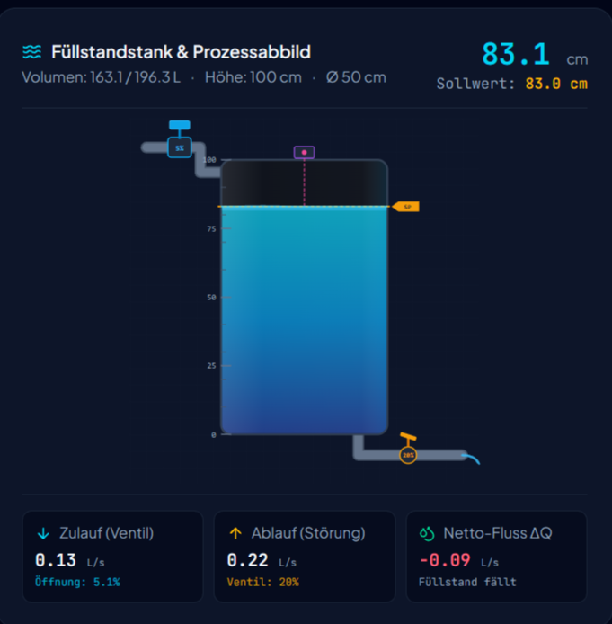

<p align="center">
  
</p>

<h1 align="center">TankPID</h1>

<p align="center">
  <b>Füllstandsregelung eines Tanks mit PID-Regler auf dem ESP32</b><br>
  Arduino-Sketch · 4–20 mA oder Ultraschall · Proportionalventil 0–10 V
</p>

<p align="center">
  <a href="LICENSE"></a>
  
  
</p>

---

## 🌊 Online-Simulation: TankSimPDF

Der Regelkreis lässt sich vollständig im Browser ausprobieren – ohne Hardware.
Sollwert, Kp, Ki, Kd und die Störgröße (Ablauf) sind live verstellbar, der Trend
läuft mit.

> **▶ [TankSimPDF – PID-Tanksimulator online starten](https://claude.ai/artifact/D9DELEAmUJuPA292cHqoZf)**
>
> Alternativ die Datei [`TankSimPDF.htm`](TankSimPDF.htm) aus diesem Repository
> im Browser öffnen – sie leitet auf dieselbe Simulation weiter.

Die Einheiten und Standardwerte des Sketches sind identisch mit denen der
Simulation. Parameter, die dort gut laufen, sind ein brauchbarer Startpunkt für
die echte Anlage.

<p align="center">
  
</p>

### Begleitende Erklärung

[`PID-Regelung_Fuellstandstank.pdf`](PID-Regelung_Fuellstandstank.pdf) –
„PID-Regelung einfach erklärt – Füllstandstank“: Aufbau des Regelkreises,
Wirkung von P-, I- und D-Anteil und das Vorgehen beim Einstellen.

---

## Inhalt des Repositorys

| Datei | Inhalt |
|---|---|
| [`TankPID.ino`](TankPID.ino) | Arduino-Sketch für den ESP32 (Regler, Sensorik, Bedienung über seriellen Monitor) |
| [`TankSimPDF.htm`](TankSimPDF.htm) | Verknüpfung zur Online-Simulation |
| [`PID-Regelung_Fuellstandstank.pdf`](PID-Regelung_Fuellstandstank.pdf) | Erklärung der PID-Regelung am Füllstandstank |
| [`PIDscreen.png`](PIDscreen.png) | Screenshot der Simulation |
| [`LICENSE`](LICENSE) | MIT-Lizenz |

---

## 1. Überblick

```
Sollwert ──►(Σ)──► PID ──► Zulaufventil ──► Tank ──┬──► Istwert
            ▲ −                                    │
            └────────── Füllstandssensor ◄─────────┘
```

| Funktion | Umsetzung im Sketch |
|---|---|
| Reglertakt | fest 100 ms (10 Hz), nicht blockierend über `millis()` |
| PID | P und I auf Regelabweichung, D auf Istwert (kein Ventilschlag bei Sollwertsprung) |
| D-Filter | Tiefpass 1. Ordnung, τ = 2 s |
| Messwertfilter | 16-fach Mittelung (4–20 mA) bzw. rollender Median aus 5 (Ultraschall), danach Tiefpass τ = 0,5 s |
| Anti-Windup | Integrator stoppt, sobald das Ventil am Anschlag steht |
| Hand/Auto | stoßfreie Umschaltung, Regler übernimmt den aktuellen Ventilwert |
| Sicherheit | Sensorfehler oder Füllstand ≥ 95 cm → Zulauf ZU, Störungs-LED an |
| Parameter | über seriellen Monitor änderbar, dauerhaft im NVS speicherbar |
| Trend | Ausgabe im Format des seriellen Plotters (Arduino IDE 2.x) |

---

## 2. Hardware

### 2.1 Pinbelegung (Standard)

| Signal | GPIO | Hinweis |
|---|---|---|
| Ventil-PWM | 25 | → RC-Filter → OPV → 0–10 V |
| Sensor 4–20 mA | 34 | nur ADC1-Pins (32–39), ADC2 ist mit WLAN belegt |
| Ultraschall Trig | 26 | nur bei `SENSOR_ULTRASCHALL` |
| Ultraschall Echo | 27 | 5 V-Pegel → Spannungsteiler auf 3,3 V |
| Störungs-LED | 2 | Onboard-LED der meisten DevKits |

Beim **ESP32-S3** gibt es GPIO 34 nicht als ADC. Dort z. B. GPIO 4 (ADC1_CH3) nehmen und `PIN_SENSOR_ADC` anpassen.

### 2.2 Füllstandssensor 4–20 mA

```
 +24 V ──► Sensor (+)
           Sensor (−) ──┬──────────────► GPIO 34
                        │
                       [R] 120 Ω, 0,1 %
                        │
 GND  ──────────────────┴──────────────► GND ESP32
```

| Strom | Spannung am Shunt | Bedeutung |
|---|---|---|
| < 3,6 mA | < 0,43 V | Leitungsbruch (NAMUR NE43) → Störung |
| 4 mA | 0,48 V | 0 cm |
| 12 mA | 1,44 V | 50 cm |
| 20 mA | 2,40 V | 100 cm |
| > 21 mA | > 2,52 V | Kurzschluss / Überlast → Störung |

120 Ω lässt dem ADC genug Reserve. Er misst bei 11 dB Dämpfung sauber bis ca. 3,1 V. Zum Schutz kann man eine 3,3 V-Z-Diode und 1 kΩ in Reihe zum GPIO vorsehen.

### 2.3 Alternative: Ultraschall JSN-SR04T

Der Sensor wird oben montiert und misst nach unten auf die Wasseroberfläche.

- Totzone ca. 20 cm. Deshalb muss der Sensor **mindestens 22 cm über dem höchsten Füllstand** sitzen.
- `US_ABSTAND_LEER_CM` = gemessener Abstand Sensor → Tankboden.
- Der Echo-Pin liefert 5 V. Deshalb einen Teiler verwenden, z. B. 1 kΩ / 2 kΩ, auf 3,3 V.
- Im Sketch umschalten: `#define SENSOR_TYP SENSOR_ULTRASCHALL`

### 2.4 Ventilausgang 0–10 V

Der ESP32 erzeugt ein PWM-Signal (19,5 kHz, 12 Bit). Ein RC-Filter glättet es zu 0–3,3 V, ein Operationsverstärker hebt es auf 0–10 V an.

```
                           +15…24 V
                              │
GPIO 25 ──[10 kΩ]──┬────── (+)│
                   │        LM358 ─────┬──────► Ventil 0–10 V
                 [1 µF] ┌── (−)        │
                   │    │              │
                  GND   ├───[20 kΩ]────┘
                        │
                      [10 kΩ]
                        │
                       GND
```

- Verstärkung = 1 + 20 kΩ / 10 kΩ = **3,0** → 3,3 V × 3 = 9,9 V
- Grenzfrequenz RC = 1 / (2π · 10 kΩ · 1 µF) ≈ 16 Hz. Das ist schnell genug für das Ventil und glättet die PWM gut.
- **LM358** braucht für 10 V Ausgang eine Versorgung von mindestens 12 V (besser 15–24 V), weil er nicht bis zur oberen Schiene aussteuert.
- Mit `VENTIL_KAL_FAKTOR` stellt man ein, dass bei 100 % genau 10,00 V anliegen.

**Sicherheit:** Am besten ein stromlos geschlossenes Ventil verwenden (0 V = ZU). Fällt der ESP32 aus, schließt der Zulauf von selbst.

---

## 3. Inbetriebnahme

1. **Konfiguration prüfen** (Abschnitt 1 im Sketch): Sensortyp, Pins, Tankhöhe, Messbereich.
2. Sketch hochladen und den seriellen Monitor mit **115200 Baud** öffnen.
3. **Sensor prüfen:** `info` eingeben. Der Sensorstrom und der Istwert müssen zum tatsächlichen Füllstand passen.
4. **Ventil prüfen im Handbetrieb:** `hand 0`, `hand 50`, `hand 100`. Am Ventilausgang ca. 0 V, 5 V und 10 V messen.
5. **Automatik:** `auto`. Der Regler übernimmt stoßfrei.
6. **Trend ansehen:** `plot` und dann Werkzeuge → Serieller Plotter.
7. Passen die Parameter, `save` eingeben. Sie bleiben dann auch nach einem Neustart erhalten.

### Befehle

| Befehl | Wirkung |
|---|---|
| `sp 83` | Sollwert in cm (max. 92 cm, unter der Überlaufgrenze) |
| `kp 10` | P-Verstärkung in %/cm |
| `ki 0.1` | I-Verstärkung in %/(cm·s) |
| `kd 0` | D-Verstärkung in %·s/cm |
| `hand 30` | Handbetrieb, Ventil fest auf 30 % |
| `auto` | Automatikbetrieb |
| `save` | Sollwert und Parameter dauerhaft speichern |
| `plot` | Plotter-Ausgabe an/aus |
| `info` | Status, Anteile P/I/D, Sensorstrom |
| `?` | Hilfe |

---

## 4. Regler einstellen

Startwerte: **Kp = 10, Ki = 0,1, Kd = 0** (PI-Regler). Für einen Tank mit 50 cm Durchmesser und ca. 2,5 L/s maximalem Zulauf passt das gut.

1. Ki und Kd auf 0 setzen. Kp erhöhen, bis der Füllstand flott reagiert, aber nicht schwingt.
2. Ki langsam erhöhen, bis die bleibende Abweichung in angemessener Zeit verschwindet.
3. Kd nur verwenden, wenn es nach Störungen zu stark überschwingt. Bei unruhigem Sensor eher weglassen.
4. Mit einer echten Störung testen: Ablaufventil deutlich weiter öffnen und im Plotter beobachten.

**Hinweis zur Umrechnung:** Hat der eigene Tank einen anderen Querschnitt oder ein anderes Ventil, ändert sich die Wirkung der Parameter. Doppelte Tankfläche bedeutet etwa halb so schnelle Füllstandsänderung. Dann können Kp und Ki ungefähr verdoppelt werden.

---

## 5. Was im Code wichtig ist

**D auf Istwert statt auf Regelabweichung**
Ändert man den Sollwert sprunghaft, springt auch e. Ein D-Anteil auf e würde dann einen kurzen, sehr großen Ventilschlag erzeugen („Derivative Kick“). Auf den Istwert angewendet reagiert D nur auf echte Füllstandsänderungen.

**Anti-Windup**
Steht das Ventil schon auf 100 % und der Füllstand ist trotzdem zu niedrig, wird der Integrator nicht weiter aufgeladen. So schießt der Füllstand nach einer Störung nicht über.

**Stoßfreie Umschaltung**
Beim Wechsel von Hand auf Auto wird der Integrator mit dem aktuellen Ventilwert vorbelegt. Das Ventil springt dadurch nicht.

**Echte Abtastzeit**
`dt` wird aus `micros()` gemessen statt fest angenommen. Kurze Verzögerungen, z. B. durch serielle Ausgabe, verfälschen den I- und D-Anteil so nicht.

---

## 6. Mögliche Erweiterungen

- Weboberfläche mit Prozessbild und Trend über WLAN
- MQTT-Anbindung an die Hausautomation
- Trockenlaufschutz der Pumpe über Minimal-Füllstand
- Zweiter, unabhängiger Schwimmerschalter als Überlaufschutz in Hardware

---

## 7. Lizenz

Veröffentlicht unter der [MIT-Lizenz](LICENSE). Nutzung, Änderung und Weitergabe
sind frei, auch kommerziell – Lizenz- und Copyright-Hinweis bitte beibehalten.

**Haftungsausschluss:** Der Sketch ist ein Lern- und Demonstrationsprojekt.
Er ist nicht für sicherheitsgerichtete Anwendungen geeignet. Ein Überlaufschutz
muss unabhängig in Hardware ausgeführt werden (z. B. Schwimmerschalter, der den
Zulauf direkt abschaltet).

---

<p align="center">
  <br>
  <sub>RwTec · 2026</sub>
</p>
